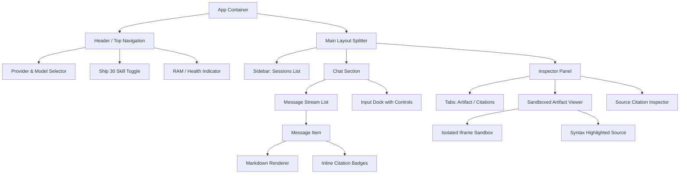

# User Interface & Experience Design Specification
## The Lenny Growth Assistant

**Design Baseline:** Phase 1 Foundation  
**Aesthetic Style:** Modern Premium Dark Mode, Glassmorphic Accents, Refined Typography, High Information Density  

---

## 1. Visual Design Philosophy & Design Tokens

The Lenny Growth Assistant interface is crafted to evoke high-craft, professional product thinking—reminiscent of Linear, Vercel, and Raycast. The design prioritizes typography, readability of long-form text, visual hierarchy of growth frameworks, and safety for interactive artifacts.

### 1.1 Color Palette & Variables (`tokens.css`)

```css
:root {
  /* Surface & Background Hierarchy */
  --bg-primary: #0a0d14;       /* Deep obsidian canvas */
  --bg-secondary: #101622;     /* Elevated card/sidebar background */
  --bg-tertiary: #162032;      /* Hover states & borders */
  --bg-card: rgba(16, 22, 34, 0.75);
  --bg-glass: rgba(16, 22, 34, 0.65);

  /* Primary Accent & Brand (Lenny Amber/Gold & Product Indigo) */
  --accent-primary: #f59e0b;    /* Warm Amber (Lenny Brand resonance) */
  --accent-primary-hover: #d97706;
  --accent-glow: rgba(245, 158, 11, 0.15);
  
  --accent-indigo: #6366f1;     /* Engineering / Growth Loop Indigo */
  --accent-indigo-hover: #4f46e5;
  --accent-indigo-glow: rgba(99, 102, 241, 0.15);

  /* Functional Status Colors */
  --status-success: #10b981;    /* Grounded / verified citation */
  --status-warning: #f59e0b;    /* Local Ollama active / partial match */
  --status-error: #ef4444;      /* Retrieval error / timeout */
  --status-info: #3b82f6;       /* Ship 30 mode active */

  /* Typography Colors */
  --text-primary: #f8fafc;      /* Crisp headline and body */
  --text-secondary: #94a3b8;    /* Subtitles, timestamps, metadata */
  --text-muted: #64748b;        /* Placeholder, inactive items */
  --text-accent: #fbbf24;

  /* Borders & Dividers */
  --border-subtle: rgba(255, 255, 255, 0.08);
  --border-prominent: rgba(255, 255, 255, 0.16);
  --border-focus: rgba(245, 158, 11, 0.5);

  /* Shadows & Glassmorphism */
  --glass-blur: blur(12px);
  --shadow-subtle: 0 4px 12px rgba(0, 0, 0, 0.4);
  --shadow-elevated: 0 12px 32px rgba(0, 0, 0, 0.6);
  --shadow-accent: 0 0 20px rgba(245, 158, 11, 0.2);

  /* Spacing Scale */
  --space-2xs: 4px;
  --space-xs: 8px;
  --space-sm: 12px;
  --space-md: 16px;
  --space-lg: 24px;
  --space-xl: 32px;
  --space-2xl: 48px;

  /* Radii */
  --radius-sm: 6px;
  --radius-md: 10px;
  --radius-lg: 16px;
  --radius-full: 9999px;
}
```

---

## 2. Layout & Viewport Architecture

The interface uses a flexible, split-screen or multi-pane desktop layout:

```
+----------------------------------------------------------------------------------------------------+
|  [Logo] Lenny Growth Assistant      [Provider: Cloud (Claude) v]  [Skill: Ship 30 Mode (ON)]  [⚙]  |
+----------------------------------------------------------------------------------------------------+
|               |                                                   |                                |
|  PAST CHATS   |                   CONVERSATION STREAM             |        ARTIFACT VIEWER /       |
|               |                                                   |        CITATION DRAWER         |
|  • Brian C.   |  User: "How does Figma think about growth loops?" |                                |
|    Roadmap    |                                                   |  [Tab: Artifact | Citations]   |
|               |  Assistant:                                       |  ----------------------------  |
|  • Pricing    |  Elena Verna (Ep #58) emphasizes that loops...    |  Interactive HTML/CSS Preview  |
|    Strategy   |  [1: Elena Verna (14:32)]                         |  +--------------------------+  |
|               |                                                   |  | (Sandboxed Iframe)       |  |
|  • Shreyas    |  ### The Product-Led Loop:                        |  | Product Loop Calculator  |  |
|    LNO Frame  |  1. Sign-up Trigger                               |  | [Inputs: Virality Rate]  |  |
|               |  2. Value Revelation                              |  | [Result: 1.4x K-factor]  |  |
|  [+ New Chat] |                                                   |  +--------------------------+  |
|               |  -----------------------------------------------  |                                |
|               |  [ Input: Ask about growth, roadmaps, retention ] |  [Copy Code]  [Open Fullscreen]|
|               |  [Toggle Ship 30]  [Provider: Claude]   [Send ->] |                                |
+---------------+---------------------------------------------------+--------------------------------+
```

### 2.1 Three-Column Responsive Behavior
- **Left Column (Sidebar - 260px):**
  - Session history list with title, model used, and last active timestamp.
  - Quick action: "New Session" button.
  - Storage & memory indicator (shows local DB status and provider status).
  - Can collapse into an icon bar or drawer on narrow screens.
- **Center Column (Main Chat - Flexible 600px - 850px):**
  - Message stream with clean role differentiation (User bubble vs. Markdown-rendered Assistant cards).
  - Interactive citation badges embedded directly in text stream (`[1] Elena Verna (14:32)`).
  - Bottom sticky input dock with model switcher, Ship 30 for 30 toggle, and send action.
- **Right Column (Artifact & Citation Inspector - 420px to 550px):**
  - Appears smoothly when an artifact is generated or when the user clicks a citation badge.
  - Tabbed interface switching between:
    - **Artifact View:** Sandboxed HTML/CSS/JS preview or rendered Markdown.
    - **Source Citations:** Full episode context, exact quote, speaker photo/icon, and timestamp link.

---

## 3. Component Hierarchy



---

## 4. API Boundaries & Communication Contracts

All API endpoints reside under `/api/v1/`.

### 4.1 Health, Liveness & Readiness Probes
- **`GET /api/v1/health/live` (Liveness)**
  - HTTP 200: Returns `{"status": "alive"}` for Kubernetes/process supervisors.
- **`GET /api/v1/health/ready` (Readiness)**
  - HTTP 200: PostgreSQL ping (`SELECT 1`) succeeded -> `{"status": "ready", "database": "connected"}`.
  - HTTP 503: PostgreSQL unavailable -> `{"status": "not_ready", "database": "disconnected", "error": "Database unavailable"}`.
- **`GET /api/v1/health` (System Diagnostics)**
  - HTTP 200 (or 503 if DB disconnected):
    ```json
    {
      "status": "healthy",
      "timestamp": "2026-10-09T10:30:00Z",
      "version": "1.0.0",
      "database": "connected",
      "provider_cloud": "configured",
      "provider_ollama": "available",
      "system_memory_mb": {
        "used": 4200,
        "available": 3800,
        "percent": 52.5
      }
    }
    ```

### 4.2 Chat Session Persistence Endpoints (Phase 2)
- **`POST /api/v1/sessions` (Create Session)**
  - Request: `{"title": "Pricing Strategy", "provider": "cloud", "model_name": "claude-3-5-sonnet", "active_skill": "ship30", "user_metadata": {}}`
  - Response: HTTP 201 Created -> `SessionResponse`
- **`GET /api/v1/sessions?limit=50&offset=0` (List Sessions)**
  - Response: HTTP 200 OK -> `{"items": [SessionSummaryResponse], "total": 1, "limit": 50, "offset": 0}`
- **`GET /api/v1/sessions/{session_id}` (Get Session with Messages)**
  - Response: HTTP 200 OK -> `SessionWithMessagesResponse` (includes messages and citations)
  - HTTP 404: Session not found
- **`DELETE /api/v1/sessions/{session_id}` (Delete Session)**
  - Response: HTTP 204 No Content (cascades to messages and citations)
  - HTTP 404: Session not found
- **`POST /api/v1/sessions/{session_id}/messages` (Store User Message)**
  - Request: `{"content": "How should I structure my B2B SaaS pricing page?", "role": "user", "provider_metadata": {}}`
  - Response: HTTP 201 Created -> `MessageResponse`
  - HTTP 404: Session not found

### 4.3 Chat & Streaming Boundary (Phase 3)
- **`POST /api/v1/chat/message`**
  - Request:
    ```json
    {
      "session_id": "9b1deb4d-3b7d-4bad-9bdd-2b0d7b3dcb6d",
      "message": "How should I structure my B2B SaaS pricing page?",
      "provider": "cloud",
      "model": "cloud-model-identifier",
      "skill": "ship30",
      "stream": true
    }
    ```
  - Response: Server-Sent Events (`text/event-stream`)
    ```text
    event: session_info
    data: {"session_id":"9b1deb4d-3b7d-4bad-9bdd-2b0d7b3dcb6d"}

    event: token
    data: {"delta":"Pricing"}

    event: token
    data: {"delta":" is a reflection of value..."}

    event: citation
    data: {"citation_index":1,"guest_name":"Madhavan Ramanujam","episode_title":"Monetizing Innovation","timestamp":"22:15","quote":"Start with willingness to pay before writing code."}

    event: artifact_start
    data: {"id":"art-123","type":"html","title":"B2B Tier Comparison Component"}

    event: artifact_chunk
    data: {"chunk":"<div class=\"pricing-card\">..."}

    event: artifact_end
    data: {"id":"art-123"}

    event: done
    data: {"total_tokens":420,"finish_reason":"completed"}
    ```

---

## 5. Artifact Security & Safe Isolation Specifications

To fulfill strict security criteria:
1. **Favored Script-Disabled Sandboxing for Static HTML/CSS:**
   - `<iframe sandbox="" srcdoc={sanitizedHtml} />`
   - For all static HTML/CSS artifacts, scripts are strictly disabled via an empty `sandbox=""` attribute.
   - Omission of `allow-same-origin` guarantees origin isolation (`null` origin), completely shielding tokens, local storage, and cookies.
   - Omission of `allow-top-navigation` prevents frame breakout.
2. **CSP Injection in `srcdoc`:**
   ```html
   <!DOCTYPE html>
   <html>
     <head>
       <meta charset="utf-8" />
       <!-- Restrictive CSP: scripts disabled for static preview -->
       <meta http-equiv="Content-Security-Policy" 
             content="default-src 'none'; style-src 'unsafe-inline'; script-src 'none'; img-src data: https:; form-action 'none';" />
       <style>
         body { margin: 0; padding: 16px; font-family: -apple-system, BlinkMacSystemFont, 'Segoe UI', Roboto, sans-serif; background: #0f172a; color: #f8fafc; }
       </style>
     </head>
     <body>
       <!-- Generated Code Injected Here -->
     </body>
   </html>
   ```
3. **Optional Interactive Execution Guard:**
   - Only upon explicit user toggle (`is_interactive: true`) is `allow-scripts` applied, while `allow-same-origin` remains strictly absent.

4. **Tabbed Artifact Viewer Controls:**
   - Visual toggle: `[Preview]` vs `[Source Code]`.
   - Copy-to-clipboard button with visual confirmation.
   - Expand to full-bleed modal preview.
